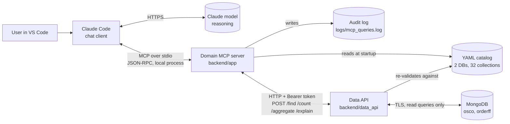
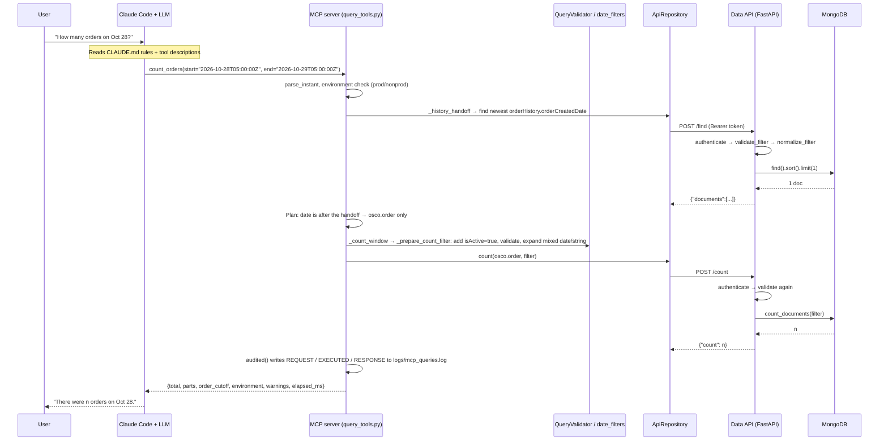

# OSCO Chatbot: Presentation Brief

Audience: engineering managers and directors. Everything here is based on the code in this repo as of 2026-11-02.
File references are clickable in VS Code.

---

## 0. What it is

A **chat assistant that answers questions about OSCO and orderff data in plain English**, such as "how many
orders were created yesterday?", "which stores had the most cancellations last week?" or "compare Thanksgiving
this year with last year".

It has three parts:

| Layer | What runs it today | What it does |
|---|---|---|
| **Chat client + LLM** | Claude Code in VS Code (Claude model) | Understands the question, picks tools, writes the answer |
| **Domain MCP server** (this repo) | `python -m backend.app.main`, started by Claude Code | Gives the LLM 12 tools. Checks every query against a curated catalog, strips PII, logs every call |
| **Data API** (this repo) | `python -m backend.data_api.main`, FastAPI on `127.0.0.1:8081` | The only part that connects to MongoDB. Read-only, requires a token, and checks every query a second time |



---

## 1. Execution flow

### 1a. Startup (once per chat session)

Claude Code starts the MCP server as a child process, using the entry in `~/.claude.json`
(`.venv/bin/python -m backend.app.main`, transport `stdio`).

| Step | File → function | What happens |
|---|---|---|
| 1 | [main.py](../backend/app/main.py) → module import | Calls `create_mcp_server()`, then `mcp.run(transport="stdio")` |
| 2 | [mcp_server.py](../backend/app/mcp_server.py) → `create_mcp_server` | Builds dependencies, configures logging, creates `FastMCP`, registers tools |
| 3 | [dependencies.py](../backend/app/dependencies.py) → `build_dependencies` | Wires everything together and picks `ApiRepository` (API mode) or `MongoRepository` (direct mode) |
| 4 | [config.py](../backend/app/config.py) → `Settings` | Reads `.env`. `validate_runtime_settings` refuses to start if a required setting is missing. The `environment` property decides prod vs nonprod |
| 5 | [yaml_schema_catalog.py](../backend/app/catalog/yaml_schema_catalog.py) → `YamlSchemaCatalog.__init__` | `_load_catalog` reads `databases.yaml`. `_load_all_schemas`/`_load_schema` read 32 schema YAMLs (`orderHistory` inherits its fields from `order`). Everything is validated with Pydantic models |
| 6 | [schema_index.py](../backend/app/catalog/schema_index.py) → `SchemaIndex._build` | Builds an in-memory keyword index of databases, collections and fields (with synonyms and examples) for natural-language lookup |
| 7 | [api_repository.py](../backend/app/db/api_repository.py) → `ApiRepository.__init__` | Creates one `httpx.Client` with the base URL, Bearer token and 60 s timeout. **No MongoDB connection is opened by the MCP server** |
| 8 | [logging_config.py](../backend/app/logging_config.py) → `configure_logging` | Logs go to stderr with IST timestamps. `SecretRedactionFilter` masks Mongo URIs |
| 9 | `register_diagnostic_tools`, `register_schema_tools`, `register_query_tools` | Registers the 12 tools listed below with FastMCP |

**The 12 tools the LLM can call:**

| Group | Tools | Touches the database? |
|---|---|---|
| Diagnostic ([diagnostic_tools.py](../backend/app/tools/diagnostic_tools.py)) | `health_check`, `mongodb_ping` | ping only |
| Schema ([schema_tools.py](../backend/app/tools/schema_tools.py)) | `list_databases_context`, `list_collections_context`, `get_collection_context`, `search_schema_context`, `resolve_query_target` | **No**, catalog only |
| Query ([query_tools.py](../backend/app/tools/query_tools.py)) | `find_documents`, `count_documents`, `aggregate_documents`, `explain_find_query`, `count_orders` | Yes, through the data API |

There are no insert, update, delete or drop tools.

### 1b. One question, end to end

Example: *"How many OSCO orders were created on Oct 28, 2026?"*



### 1c. Function by function (query path)

**MCP server side: [query_tools.py](../backend/app/tools/query_tools.py)**

| Function | Role |
|---|---|
| `count_orders` | The main tool for order counts. Parses the dates, finds the `order`/`orderHistory` handoff, plans which collection covers which date range, counts each part and adds them up |
| `_history_handoff` | Finds the newest `orderCreatedDate` in `osco.orderHistory`. That is where `osco.order` takes over. If the lookup fails, it falls back to 3 months before now |
| `_count_range` | Splits long ranges into 31-day chunks and counts them on 4 threads in parallel |
| `_count_window` | Counts one window. If the data API times out, it splits the window in half and retries, down to a minimum of 1 day |
| `_prepare_count_filter` | Adds `isActive:true` (one version per order), then validates the filter, normalizes it and expands date conditions |
| `_applies_active_only` / `_mentions_is_active` | Decide whether to add the `isActive` default. A caller's own `isActive` condition wins |
| `_skipped_in_nonprod` / `_skipped_result` | In nonprod, `orderHistory` is never queried and returns `skipped: true` |
| `_environment_warnings` | In prod, an empty `orderHistory` result means the filter is wrong. The tool says so instead of reporting zero |
| `find_documents` | get_schema → cap_limit → validate_filter → normalize → expand dates → validate_sort → build projection → repo.find → sanitize |
| `count_documents` | Same checks, then `repo.count` |
| `aggregate_documents` | Adds a leading `$match isActive`, runs `validate_pipeline` and date expansion, calls `repo.aggregate` and sanitizes the result |
| `explain_find_query` | Returns the query plan (index usage) without returning documents |

**Shared services**

| File → function | Role |
|---|---|
| [query_validator.py](../backend/app/services/query_validator.py) → `validate_filter` | Rejects unknown fields, fields not marked filterable, operators outside the allowlist, and regex on fields where it isn't allowed |
| `_reject_blocked_recursive` | Blocks `$where`, `$function`, `$accumulator`, `$out` and `$merge` at any nesting depth |
| `validate_pipeline` | Allows only these stages: `$match $project $sort $limit $skip $group $unwind $addFields $count`. That means no `$lookup` (no cross-collection joins) and no `$out`/`$merge` (no writes) |
| `cap_limit` | Caps results at `MCP_MAX_DOCUMENTS_PER_QUERY` (50) |
| `normalize_filter` / `_normalize_field_value` | Converts ObjectId strings to ObjectIds |
| [date_filters.py](../backend/app/services/date_filters.py) → `expand_mixed_date_filter` | Dates are stored as BSON dates in some documents and ISO strings in others. Each date condition is rewritten as an `$or` that matches both, so neither kind is silently missed |
| [projection_policy.py](../backend/app/services/projection_policy.py) → `build_projection` | Default projection uses only `return_by_default` fields. Asking for a PII field raises an error |
| [response_sanitizer.py](../backend/app/services/response_sanitizer.py) → `format_documents` | Removes `pii`/`sensitive` fields (including nested paths and arrays), converts BSON types to JSON, and truncates at 1 MB |
| [target_resolver.py](../backend/app/services/target_resolver.py) → `resolve` | Scores the request against the catalog index and returns database, collection, candidate fields and a confidence level |
| [query_audit.py](../backend/app/query_audit.py) → `audited` / `_write` | Wraps every query tool. Logs the request, the exact executed query, the result (at most 10 docs and 6,000 characters) and the timing. **Raw unsanitized documents are never logged** |

**Transport and data API side**

| File → function | Role |
|---|---|
| [api_repository.py](../backend/app/db/api_repository.py) → `find`/`count`/`aggregate`/`explain_find` → `_request` | Sends Extended JSON (so dates and ObjectIds survive) over HTTP with the Bearer token. Turns 401, other 4xx/5xx and non-JSON responses into `DataApiError` |
| [data_api/main.py](../backend/data_api/main.py) → `create_app` | FastAPI app. Each endpoint runs `get_schema`, `cap_limit`, `validate_filter`/`validate_pipeline` and `normalize_filter` **again**, then calls MongoDB |
| `handle_bad_query` / `handle_database_error` | Return 400 for rejected queries and a generic 502 for DB errors. The real cause is logged with credentials redacted |
| [data_api/auth.py](../backend/data_api/auth.py) → `build_authenticator` | Bearer token or Basic auth, compared in constant time (`secrets.compare_digest`) |
| [data_api/settings.py](../backend/data_api/settings.py) → `validate_auth_configured` | **Fails closed**: the API refuses to start without credentials configured |
| [mongo_client.py](../backend/app/db/mongo_client.py) → `MongoClientProvider.client` | Connects lazily, over TLS (`certifi` or a corporate CA file), with a 5 s server-selection timeout |
| [mongo_repository.py](../backend/app/db/mongo_repository.py) | Thin pymongo calls. `aggregate` always appends `$limit` |

---

## 2. API architecture and how to show it

**Style:** internal REST (JSON over HTTP). The data API is a contract between the MCP server and MongoDB:

| Method | Path | Body | Returns |
|---|---|---|---|
| GET | `/health` | | `{"ok": true}` (pings Mongo) |
| POST | `/find` | `{database, collection, filter, projection, sort, limit}` | `{"documents": [...]}` |
| POST | `/count` | `{database, collection, filter}` | `{"count": n}` |
| POST | `/aggregate` | `{database, collection, pipeline, limit}` | `{"documents": [...]}` |
| POST | `/explain` | `{database, collection, filter}` | `{"explain": {...}}` |

All endpoints require `Authorization: Bearer <token>` (or Basic auth). There are no PUT, PATCH or DELETE endpoints.

**Why the API layer exists:** it separates the part that holds credentials from the part the LLM talks to.
In production the data API becomes a deployed service in the data zone, and the MCP server or chatbot never
needs Mongo credentials.

### Live demo (about 3 minutes)

```bash
# Terminal 1: start the data API
python3 -m backend.data_api.main            # serves http://127.0.0.1:8081

# Browser: Swagger UI, auto-generated from the code
open http://127.0.0.1:8081/docs              # click "Authorize", paste the token, try POST /count

# Terminal 2: security checks
set -a; source .env; set +a
# a) no token → 401
curl -s -o /dev/null -w '%{http_code}\n' http://127.0.0.1:8081/health
# b) code injection attempt → 400 "Dangerous MongoDB operator/stage '$where' is not allowed."
curl -s -X POST http://127.0.0.1:8081/count -H "Authorization: Bearer $DATA_API_TOKEN" \
  -H 'Content-Type: application/json' -d '{"database":"osco","collection":"order","filter":{"$where":"sleep(5000)"}}'
# c) a database that isn't in the catalog → 400 "Unknown database 'admin'"
curl -s -X POST http://127.0.0.1:8081/count -H "Authorization: Bearer $DATA_API_TOKEN" \
  -H 'Content-Type: application/json' -d '{"database":"admin","collection":"system.users","filter":{}}'

# Terminal 3: watch the audit trail while you ask the chatbot a question
tail -f logs/mcp_queries.log

# Optional: call a tool without the LLM (shows the MCP layer by itself)
python3 scripts/mcp_query.py count_orders '{"start":"2026-10-28T05:00:00Z","end":"2026-10-29T05:00:00Z"}'
```

Note: calling `/count` directly does **not** add `isActive:true` (that happens in the MCP layer), so its numbers
can be higher than the chatbot's.

---

## 3. Caching: what is stored and where

| Item | Cached or stored? | Where | Notes |
|---|---|---|---|
| Query results | **Not cached** | | Every question runs live against MongoDB, so numbers are always current |
| Schema catalog + search index | In memory, per process | MCP server and data API | Loaded once at startup. Restart after editing YAML |
| HTTP connections | Connection pool | `httpx.Client` in MCP server | Performance only, no data |
| Mongo connections | Connection pool | `MongoClient` in data API | Performance only |
| Audit log | **On disk** | `logs/mcp_queries.log` (git-ignored) | Sanitized results, at most 10 docs per call. Raw docs are never written. No rotation yet |
| Data API log | stderr | Terminal | Filter and result count only |
| Chat transcripts | **On disk** | `~/.claude/projects/<project>/*.jsonl` | Saved by Claude Code. Contains tool results, sanitized by default |
| LLM prompt cache | Provider-side, short TTL | Model provider | Caches the system prompt and tool definitions to save tokens. Not a data store |

---

## 4. Session memory

**Short answer: the MCP server and data API are stateless by design. Conversation memory lives in the chat
client, and only for the current chat.**

- **Within one chat:** the LLM remembers earlier turns because they stay in its context window. That is why
  "now break that down by banner" works as a follow-up.
- **New window or new chat:** a fresh context starts and Claude Code starts a **new MCP server process**.
  Nothing from the previous chat carries over. This is expected, not a bug.
- **What does carry across sessions:**
  - `CLAUDE.md`: project rules (routing, `isActive`, date handling), checked into git and loaded every session.
  - Claude Code auto-memory (`MEMORY.md`): per-user notes on the local machine.
  - Past chats can be **resumed manually** (the past-conversations list in VS Code, or `claude --resume`), because
    transcripts are saved locally. They are not merged into a new chat automatically.
- **Why this is good for governance:** no server-side store of question history or results, nothing shared
  between users, and no retention policy to manage on the server.
- **Roadmap ([ARCHITECTURE.md](ARCHITECTURE.md)):** the planned LangGraph orchestration service will manage
  sessions with a checkpointer (for example Postgres or Redis) keyed by user and session ID, with a TTL. That
  gives multi-turn memory across windows while keeping each user's history separate.

---

## 5. Is the OSCO Chatbot a net-new application? (whole application)

**Yes.** "Net-new" means a brand-new application, not a feature added to an existing system. The OSCO Chatbot
as a whole is net-new: a new repo, new services, a new way to read OSCO data, and a new AI use case.

| | Net-new (built for this app) | Reused (already exists) |
|---|---|---|
| Services | Domain MCP server, data API, YAML data catalog, audit log | |
| Planned | Orchestration service (LangGraph, SSO, session store, chat UI), Kafka/Grafana MCPs | |
| Data | **No new database, no copy of the data, no schema changes** | OSCO / orderff MongoDB, read-only |
| AI | | Claude, through the enterprise Claude Code licence |
| OSCO system | **No changes.** The chatbot is a read-only consumer | |

What being net-new usually triggers in a governance process (confirm the exact list with your architecture and
security teams):
- architecture review
- security review and threat model
- data classification and PII/CCPA review (`ccpa_audit_rits` is in the catalog)
- AI/LLM use approval
- application registration (CMDB, owner, support model)
- service accounts and secrets in a vault
- onboarding to central logging and monitoring

Key message: *"It's a new application, but a low-risk one. It's read-only, creates no new data stores, makes no
changes to OSCO, and every query is allowlisted and audited."*

### Network footprint of the whole application

There is one outbound internet call at runtime: the call to the LLM.

| Hop | Protocol | Leaves the machine? | Leaves the corporate network? |
|---|---|---|---|
| User → Claude Code (VS Code) | local UI | No | No |
| Claude Code ↔ LLM provider | HTTPS | Yes | **Yes**: question, tool descriptions, sanitized results |
| Claude Code ↔ MCP server | stdio (pipes between local processes, no network port) | No | No |
| MCP server → data API | HTTP to `127.0.0.1:8081` (bound to localhost only) | No | No |
| Data API → MongoDB | TLS | Yes | Should not. The host name contains `-pl-`, which usually means a private-link endpoint. **Confirm with the DBA** |
| Anything else | none in the code (no telemetry, no other HTTP calls) | | |

`pip install` contacts the package index at setup time only.

So the application is **not air-gapped**. Everything except the LLM call stays on the machine or the private
network. For production, route the LLM call through the approved enterprise endpoint (zero data retention,
private connectivity if available).

> Flag: the local `.env` points at the **prod** MongoDB (`osco-prod-mongodb-01-...`). A developer laptop reading
> prod data is a governance question in itself. For production, the data API should run as a server-side
> service, not on laptops.

---

## 6. Why a custom domain MCP instead of a generic/organizational MongoDB MCP

A generic MongoDB MCP (for example the public `mongodb-mcp-server` or an org-wide generic one) gives the LLM raw
`find`/`aggregate`/`count` against whatever the connection string allows. *Before the meeting, check which flags
and permissions the org MCP actually runs with, so you compare against its real configuration.*

### Point 1: correct answers, not just syntactically valid queries
A generic MCP will run a query that looks right and returns the wrong number. This server builds OSCO business
rules into the tools:
- **Order versions:** each order has several versions. `isActive:true` is added automatically, so each order
  counts once. Without it, counts are inflated.
- **Retention split:** prod orders move from `osco.order` to `osco.orderHistory` in batches. `count_orders` finds
  the actual handoff point, splits the range there and adds the parts (`parts` and `order_cutoff` in the response).
  A generic MCP would query one collection and silently under-count.
- **Mixed date types:** some documents store dates as BSON dates and others as strings. Mongo never compares the
  two, so a normal date filter silently skips one kind. `date_filters.py` rewrites each condition to match both.
- **Timeout handling:** long ranges are chunked and run in parallel, and windows that time out are split and
  retried.

### Point 2: allowlist security instead of trusting the connection string
- Only **2 databases / 32 collections** declared in YAML can be queried. `admin`, other databases and unknown
  collections are rejected.
- **Field-level allowlist:** only fields marked `filterable`/`sortable` can be used.
- **Operator and stage allowlist:** no `$where`/`$function`/`$accumulator` (server-side JavaScript), no
  `$out`/`$merge` (writes), no `$lookup` (cross-collection data pulls).
- **Checked twice:** once in the MCP server and again in the data API, so a client that skips the MCP layer is
  still blocked.
- **Structurally read-only:** there is no write code anywhere, not just a read-only flag.

### Point 3: PII protection and auditability built in
- **PII by default:** fields are tagged `pii`/`sensitive` in the catalog (for example `customer.name.*`,
  `customer.clubCardNumber`, `customer.memberId`, `customer.address.*`; `osco.order` alone has dozens of tagged
  fields). They are removed from results before the LLM sees them, and asking for one in a projection is an error.
- **Credential isolation:** in API mode the MCP server never connects to Mongo. Only the data API, which can
  live in the data zone, holds the URI. Its token check fails closed and uses constant-time comparison.
- **Full audit trail:** every call records the question's tool arguments, **the exact query executed** after
  rewrites, the result and the timing. Any number the chatbot gives can be traced and reproduced.
- **Cost and blast-radius limits:** at most 50 documents and 1 MB per response, a 60 s timeout, and
  purpose-built tools like `count_orders`, so fewer tokens go to the LLM and less load goes to Mongo.

---

## 7. Security and governance: controls and known gaps

### Controls in place

| Control | Where |
|---|---|
| Read-only (no write tools or endpoints) | `query_tools.py`, `data_api/main.py` |
| Catalog allowlist for DBs, collections and fields | `yaml_schema_catalog.py`, `query_validator.py` |
| Operator/stage allowlist and recursive blocklist | `query_validator.py` |
| PII stripping on by default | `response_sanitizer.py`, `projection_policy.py` |
| Credentials only in the data API (API mode) | `dependencies.py`, `data_api/settings.py` |
| Auth fails closed, constant-time comparison | `data_api/auth.py`, `data_api/settings.py` |
| Defense in depth (validation runs twice) | `data_api/main.py` |
| Secrets redacted in logs, generic 502 errors to clients | `logging_config.py`, `data_api/main.py` |
| TLS to MongoDB | `mongo_client.py` |
| Prod/nonprod awareness in every response | `config.py`, `query_tools.py` |
| Result size and time limits | `config.py`, `response_sanitizer.py` |
| Audit log | `query_audit.py` |
| 67 automated tests (all passing) | `tests/` |

### Known gaps (better to raise these yourself than have them found)

| Gap | Risk | Fix |
|---|---|---|
| PII can leak through aggregation aliases (`$group` by a PII field, `$addFields` copies) and through fields missing from the catalog | Raw PII can reach the LLM even with sanitization on | Reject PII field references inside pipeline expressions; switch aggregate output to allow-listed fields; apply PII stripping in the data API as well |
| One shared service token, no end-user identity | The audit log can't tell **who** asked. No per-user or per-role access | SSO/OAuth at the orchestration layer, pass user identity to the data API, add a user ID to audit entries |
| Data API uses plain HTTP | Fine on `127.0.0.1`. Not fine once it is deployed on a network | TLS (or mTLS) when deployed |
| The local `.env` also contains `MONGODB_URI` | On a laptop, credential isolation is only logical, because both processes share the same file | Separate configs. The MCP side sets `OSCO_ENVIRONMENT` and never sees the URI |
| Audit log is a local, unrotated file (1.4 MB) | Not tamper-evident or centralized, and grows without limit | Ship to Splunk/ELK, add rotation and a retention policy |
| `backend/app/trust.jks` and `__pycache__` are committed to git | Repo hygiene. A truststore normally holds only public certs, but auditors will flag it | Remove from git and add to `.gitignore` |
| `MCP_READ_ONLY` is reported but not enforced | Cosmetic, since no write code exists | Document it or remove the flag |
| Mongo user privileges not verified | The data API's DB user should have only the `read` role | Confirm with the DBA. Use a dedicated read-only user |
| Queries may hit the primary node | Analytics load on the production primary | `readPreference=secondaryPreferred` or an analytics node |
| Questions and sanitized results go to the LLM provider | Data leaves the corporate network | Use the approved enterprise LLM route (zero data retention), confirmed with InfoSec |
| `/docs` (Swagger) does not require auth | Shows the API shape only, no data | Disable it in prod (`docs_url=None`) |

---

## 8. Questions a manager or director will likely ask

**Q: Can it change or delete production data?**
No. There is no write code anywhere: no write tools, no write endpoints, and the stages that can write (`$out`,
`$merge`) are blocked. As a final safeguard, the DB user should have only the `read` role.

**Q: What data goes to the AI vendor?**
The user's question, catalog metadata and **sanitized** query results. PII fields are stripped before the LLM
sees them. Sanitization is set per collection in the schema YAML (`sanitize: true`, the default), and the LLM cannot turn it off. MongoDB credentials never go to the LLM.

**Q: How do we know the numbers are right?**
Every answer can be traced in `logs/mcp_queries.log`: the exact query executed, the collections it hit, and the
counts per part. `count_orders` returns `parts` and `order_cutoff`, so the split between `order` and
`orderHistory` is visible. The routing rules were checked against real data (`orderHistory` ends at
2026-05-03), and there are 67 automated tests.

**Q: What if the AI writes a bad or malicious query?**
The validator rejects it with a clear error (unknown field, blocked operator and so on). The LLM usually corrects
itself and tries again, and the data API checks the query a second time.

**Q: Does it load the production database?**
Results are limited to 50 documents and 1 MB, with a 60 s timeout. Count ranges are chunked at 4 parallel
requests. Recommended next steps: read from a secondary or analytics node, and a compound index
`{isActive, orderCreatedDate}` (needs the DBA).

**Q: How reliable and fast is it?**
Be honest here. The audit log from the 2026-10-29 testing (565 calls, mostly `aggregate_documents` before
`count_orders` existed): **65% OK, 23% data API timeouts/errors, 12% validator rejections**, median about 5 s.
`count_orders` (chunking, retries) was added to fix the main timeout cause. A prioritized plan covers the rest:
fix the validator's handling of computed fields after `$group`, add intent-level tools, compact schema
responses, and indexes or pre-aggregation.

**Q: Who can use it today, and how do we control access?**
Today: developers with repo access and the data API token, running locally. Production needs SSO at the chat
front end, per-user identity passed to the data API, and role-based limits on which collections each group can
see (the catalog is the natural place to define that).

**Q: How do we add a new collection or business rule?**
Add a YAML file under `backend/app/resources/schemas/` and register it in `databases.yaml`. No code changes are
needed. The data owners should own these YAML files, with PII tagging reviewed. This is the governance point
for "what the AI is allowed to see".

**Q: What does it cost to run?**
Infrastructure is small (two Python services). The main cost is LLM tokens per question, which go up with schema
lookups and large results. The performance plan reduces this with compact schema cards, intent tools and prompt
caching.

**Q: Why not just build a dashboard?**
Dashboards answer questions someone predicted. This answers new ones ("same day last year, by banner, excluding
cancelled") in seconds, with the query shown. The two complement each other.

**Q: What's the path to production?**
1. Deploy the data API as an internal service (TLS, secrets manager, read-only DB user, secondary reads).
2. Build the **net-new** orchestration service (LangGraph + approved LLM endpoint + SSO + session store).
3. Centralize audit logs.
4. Close the aggregation-alias PII gap and strip PII in the data API too.
5. Add the Kafka and Grafana MCP servers (read-only) for cross-system root-cause analysis.

**Q: What's the blast radius if the token leaks?**
Read-only access to 32 allowlisted collections, without PII if the gap above is closed, limited to 50 docs per
call, and only from inside the network where the API runs. Rotate the token through the secrets manager.

**Q: How does prod vs nonprod work?**
The environment comes from `OSCO_ENVIRONMENT`, or is inferred from the Mongo host name. It is reported in every
response. In nonprod, `orderHistory` is never queried.

**Q: Is it extensible to other systems?**
Yes. The design is one MCP server per domain (Mongo built; Kafka, Grafana and the knowledge base planned), each
with its own allowlist and audit log, orchestrated by LangGraph. A bad tool call can only affect its own domain.

---

## 9. Suggested 15-minute flow

1. Problem and value (1 min): ops and analysts wait on engineers for ad-hoc data questions.
2. Architecture diagram (2 min): section 0.
3. Live: ask the chatbot one count question and one comparison question, with `tail -f` of the audit log
   running alongside (3 min).
4. Live: Swagger UI, then the 401 and `$where` rejection curls (2 min).
5. Why custom MCP (2 min): section 6.
6. Governance: controls and gaps with fixes (3 min): section 7.
7. Ask: approve the net-new orchestration service, LLM budget, DBA time for indexes and a read-only user (2 min).
